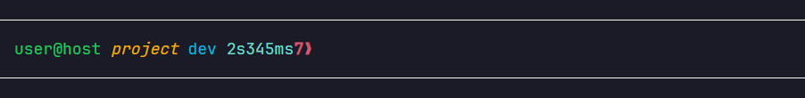
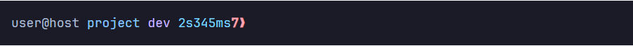
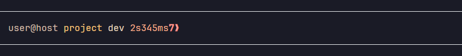
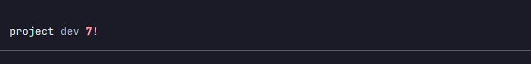
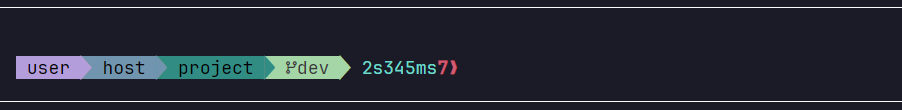

# upwsh

**u**nix-style **pwsh**：在 Windows 上提供 Unix 风格的 PowerShell 7 体验——Unix 路径、熟悉的命令、Tab 补全和原生提示符。

  

[English](README.md) · [安装](#安装) · [快速体验](#快速体验) · [CLI 工具](#cli-工具) · [主题](#主题) · [个人配置](#个人配置) · [开发说明](docs/development.md)

| `pure-classic` | `colorful-blue` |
| --- | --- |
|  |  |

提示符显示当前文件夹、Git 分支、命令耗时和退出状态，不运行 Starship。路径使用 `/d/work`、`~/projects`，语法和管道仍使用 PowerShell。

## 它增加了什么

| 能力 | 示例 |
| --- | --- |
| Unix 风格路径 | `cd /d/work`、`cd ~/Desktop` |
| 熟悉的命令 | `ls`、`cp -r`、`grep`、`touch -p` |
| Git 补全 | `git switch fe<Tab>` |
| 路径补全 | `/d/work/pro<Tab>` |
| 原生提示符 | `user@host project dev ❯` |
| 切换主题 | `upwsh theme use pure-classic` |

## 安装

在 PowerShell 7（`pwsh`）中执行：

```powershell
irm https://github.com/ityme/upwsh/raw/main/src/script/install.ps1 | iex
```

安装位置为 `~/.config/upwsh`，会把 `upwsh` 加入 Path，在当前 pwsh 中定义 `upwsh` 命令，并加载 profile。若缺少 `eza`、`dust` 或 `btm`，安装结束会提示：

```text
missing   eza, dust, btm
next      upwsh tool install eza dust btm
```

## 快速体验

```powershell
cd /d/work
ls
git switch fe<Tab>
touch -p logs/archive/app.log
```

使用 `upwsh theme use colorful-blue`，即可从默认提示符切换到连续色块主题。

## 使用路径

交互输入时，用小写盘符前缀和正斜杠表示路径：

```powershell
cd /d/work
cd ~/Desktop
cd -                         # 返回上一个目录
```

独立、未加引号的 `/c/...`、`~/...` 参数会在执行前转为 Windows 路径。引号内的文本保持原样，例如 `'use /c/demo'` 不会被改写。

含空格的路径、变量或脚本中的路径，用 `winpath` 显式转换；反向转换用 `unixpath`：

```powershell
winpath '/c/my work'          # C:/my work
unixpath 'C:\my work'         # /c/my work
cd (winpath '~/my work')
'C:\one', 'D:\two' | unixpath
```

两条命令都支持多个路径和管道输入，不要求路径存在。Tab 遇到需要引号的 Unix 绝对路径时，会生成 `(winpath '…')`。注释、内嵌脚本、重定向和 `--output=/c/a` 这类组合参数不会自动转换。

`rm` 在本地固定磁盘上把目标送进回收站。Windows 保留名（`nul`、`con`、`aux`、`prn`、`com1`–`com9`、`lpt1`–`lpt9`）不能走回收站。Tab 会跳过这些名字。删除用扩展路径：`[IO.File]::Delete('\\?\D:\work\nul')`。

## Git 补全

Git 在 Path 上时，按 Tab 补全常用子命令、分支、标签和已配置的远程名称：

```text
git sw<Tab>                  → git switch
git switch fe<Tab>           → 匹配的本地分支
git checkout v<Tab>          → 匹配的标签及其他引用
git push o<Tab>              → origin
git pull origin <Tab>        → 本地已知的 origin 分支
git checkout -- ./<Tab>      → 文件
```

Git 单词唯一匹配时，补全后自动加空格。每段都只有一个匹配时，可以连续输入 `git pul<Tab>o<Tab>d<Tab>`，不用手敲空格；多个候选的公共前缀和目录补全不加空格。

只读取本地 Git 数据，不联网、不需要额外依赖。支持 `git -C <目录>` 和 `git switch --track`，其他复杂写法回退到普通补全。查询结果缓存 1 秒，输入实际命令时清空；其他终端的改动可能延迟约 1 秒显示。

## 提示符刷新

提示符显示上次命令结束时的状态快照。空回车、注释、Ctrl+L、Tab 和编辑时按 Ctrl+C 都复用它；实际命令完成、失败或被中断后刷新一次。目录或窗口宽度变化也会刷新。

另一个窗口在同一工作目录切换分支等外部改动，会在本窗口执行下一条命令后显示。执行 `git status` 即可检查仓库并刷新提示符。

## 管理安装

| 命令 | 作用 |
| --- | --- |
| `upwsh install` | 安装或修复文件、Path 和 `upwsh` 命令，然后 load |
| `upwsh update` | 更新已有安装，保留工具、`user-settings.ps1`、额外主题 JSON 和 profile 钩子 |
| `upwsh load` | 启用启动时自动加载，并加载当前 pwsh |
| `upwsh unload` | 停止自动加载，并恢复当前会话的默认提示符 |
| `upwsh uninstall` | 先 unload，再删除安装；改过的 `user-settings.ps1` 留下，主题不留 |
| `upwsh edit` | 用 nvim 打开 `~/.config/upwsh/user-settings.ps1`，退出后重载当前 pwsh |

`upwsh install` / `upwsh update` 默认使用远程版本；开发当前项目时使用 `--local`。安装和更新都会加载当前窗口；卸载会先 unload，再删除运行时。改过的 `user-settings.ps1` 留下，主题不留。

安装目录固定为 `~/.config/upwsh`，`UPWSH_HOME` 记录这个位置。原生提示符由 `src/lib/prompt.psm1` 提供，会随当前文件夹和 Git 分支变化。命令帮助见 `upwsh --help`。

## CLI 工具

按需安装到 `~/.config/upwsh/tool/bin`：

```powershell
upwsh tool list
upwsh tool install eza rg fd fzf
upwsh tool update eza
upwsh tool update --all
upwsh tool uninstall rg
```

## 主题

两个系列，共 12 套本地主题。默认 **`pure-classic`**（原 iWonder）。切换无需重启 pwsh：

```powershell
upwsh theme list
upwsh theme use "colorful-blue"
upwsh theme use "pure-classic"
```

| 系列 | 风格 | 预览 |
| --- | --- | --- |
| `pure-*` | 终端原生背景上的简洁提示符 | [pure-classic](src/theme/pure-classic.json) |
| `colorful-*` | 连续 Powerline 色块 | [colorful-blue](src/theme/colorful-blue.json) |

[打开交互式主题画廊](docs/assets/themes/gallery.html)，离线比较所有命令状态。

### pure-* · 透明背景

| 主题 | 预览 |
| --- | --- |
| [pure-classic](src/theme/pure-classic.json) |  |
| [pure-glacier](src/theme/pure-glacier.json) |  |
| [pure-ember](src/theme/pure-ember.json) |  |
| [pure-quiet](src/theme/pure-quiet.json) |  |
| [pure-daylight](src/theme/pure-daylight.json) |  |

### colorful-* · 连续色块

| 主题 | 预览 |
| --- | --- |
| [colorful-blue](src/theme/colorful-blue.json) |  |
| [colorful-green](src/theme/colorful-green.json) |  |
| [colorful-macaron](src/theme/colorful-macaron.json) |  |
| [colorful-morandi](src/theme/colorful-morandi.json) |  |
| [colorful-cyberpunk](src/theme/colorful-cyberpunk.json) |  |
| [colorful-retro](src/theme/colorful-retro.json) |  |
| [colorful-memphis](src/theme/colorful-memphis.json) |  |

Colorful 的用户、主机、目录、Git 使用连续色块。耗时、返回码与 `❯` 用终端默认背景。非仓库、短耗时或成功时对应段隐藏，不留多余箭头。文字对比记录在各 JSON 的 `_Comment.ContrastAdjustments`。

Colorful 在提示符前留一空行（`AddNewline: true`），pure 默认关闭。Colorful 的色块后只留一个空格，耗时、返回码、提示字符与 pure 一样紧接，例如 ` 6s418ms1❯`。

上面每张图只有该主题的提示符。Quiet 隐藏耗时。深色图背景是 `#1a1b26`，Daylight 是白色。选择主题不会改终端整体背景。**Colorful 需要含 Powerline 字形的字体**，例如 JetBrainsMono Nerd Font。

想像预览页一样切换八种命令状态，下载仓库后用浏览器打开 **[docs/assets/themes/gallery.html](docs/assets/themes/gallery.html)**，无需联网或启动服务。GitHub 可能显示 HTML 源码，不直接运行页面。

所有提示符主题都在 `~/.config/upwsh/theme/`，`theme.json` 记录选择。复制一份内置 JSON、改名后再改。`Order`、`Modules` 配置颜色、排列和连接符，每份 JSON 都有中文字段说明。切换后下一次提示符生效；编辑后需重新选择同一主题。

更新会刷新 `theme/` 下的随包文件名，其它 JSON 和 `theme.json` 留下。旧名称没有别名，也不会自动重命名。文件位置和配置方式见[主题说明](docs/themes.zh-CN.md)。

## 个人配置

编辑 `~/.config/upwsh/user-settings.ps1`，在内置别名之后加载；也可 `upwsh edit` 用 nvim 打开（没有 nvim 时用 vim）。编辑器退出后会重载当前 pwsh。`upwsh.cmd` 只能重载那个子进程。`upwsh update` 不会覆盖已有文件。卸载时若文件与随包模板不同则留下，未改过的模板随运行时删除。主题一律删除。

```powershell
function global:work { cd (winpath '/d/my work') }
```

`user-settings.ps1` 里有注释掉的 `w`、`t`、`i`、`d`、`gs` 示例，取消注释并改路径即可。终端上报也可写在同一文件。默认不发送完整命令文本，字段和隐私开关见[终端上报说明](docs/terminal-reporting.md)。

## 从源码安装

```powershell
git clone https://github.com/ityme/upwsh.git
cd upwsh
upwsh install --local
```

<details>
<summary>本地、远程与源码选项</summary>

`upwsh install` / `upwsh update` 默认使用远程版本。开发当前项目时使用 `--local`，也可以用 `--source`、`--ref`、`--repo` 指定来源。管道安装同样默认 `--remote`，并读取 `UPWSH_SOURCE`、`UPWSH_REF`、`UPWSH_REPO`。

```powershell
upwsh install --source I:/ispace/upwsh
upwsh install --remote --ref dev
upwsh update --remote
```

</details>

测试、性能测量和路径转换接口维护见[开发说明](docs/development.md)。
